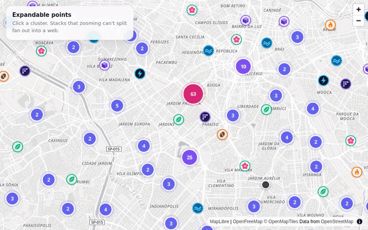

# Expandable Points

Map point clusters that fan out like a spider web when several points sit at **the exact same coordinate** — something zooming alone can never split apart.



Plain TypeScript (no framework) + [MapLibre GL](https://maplibre.org/) + [Vite](https://vite.dev/). Basemap: [OpenFreeMap](https://openfreemap.org/) (OpenStreetMap data, no API key).

## How it works

- **Click a cluster:**
  - if zooming can split it, the map zooms to the level where the cluster breaks apart;
  - if it can't (coincident points), the cluster fans out into a web: a **ring** for up to 9 points, a **spiral** beyond that.
- **Click a point** (on the map or in the web) for a popup with logo, company, address and category.
- **Close the web:** the `×` hub, a click on empty map, `Esc`, a click on another cluster, or any zoom.
- Every point shows its **company logo** with a ring in its category color.
- Honors `prefers-reduced-motion` (no animation), and web leaves are focusable buttons with an `aria-label`.

## Running

Requires Node 24+ (tests use Node's native TypeScript support).

```bash
npm install
npm run dev       # http://localhost:5173
npm test          # layout tests (node:test)
npm run build     # typecheck + production build into dist/
npm run preview   # serve the build
```

## Structure

```
src/
  main.ts          map, layers, sample data and interactions
  spider.ts        opens/closes the web (DOM + CSS animation)
  layout.ts        position of each leaf in the web (ring / spiral)
  layout.test.ts   ensures no two leaves overlap
  badge.ts         draws a logo into a round badge for the WebGL layer
  style.css
public/logos/      (fictional) logos for the sample companies
```

### Technical decisions

- **MapLibre's built-in clustering**, which runs in the library's own web worker. The web only kicks in when `getClusterExpansionZoom` exceeds `clusterMaxZoom` — i.e. when zooming won't help.
- **The web is a single HTML `Marker`** with pixel offsets, so it keeps its on-screen size while the map pans, with no recomputation. Animations use `transform`/`opacity` (compositor thread).
- **Map logos** are rasterized on a canvas (`badge.ts`) and registered with `map.addImage`, because MapLibre's `loadImage` can't decode SVG.
- **Same CORS mode on every image** (`crossOrigin = 'anonymous'`), so badges, web leaves and popups share one cache entry — each logo is downloaded exactly once.
- **MapLibre's worker is set explicitly** (`setWorkerUrl` + `?worker&url`): MapLibre v6 resolves its worker relative to its own file, which breaks once Vite bundles it.
- **Rapid clicks** are guarded by a token: async results from an older click are discarded.

## Using your own data

Sample data is generated in `src/main.ts` (`COMPANIES` and `stacks`). Each point needs:

```ts
{ company: 'company-id', name: 'Name', place: 'Address', category: 'food' | 'shop' | 'park' | 'service', logo: 'https://…/logo.png' }
```

- **Remote logos need CORS** (`Access-Control-Allow-Origin`); without it the canvas is tainted and the badge fails — the error is logged to the console and the point stays visible as a plain dot.
- Logos are cropped to a circle (`cover`); for very wide logos, switch to `contain` in `badge.ts`.

## Known limits

- The web uses one HTML button per leaf: fine up to a few hundred per cluster. Bigger stacks need a cap ("+N more") or rendering in a WebGL layer.
- All data is shipped to the browser. That works up to a few hundred thousand points (ideally passing a URL as `data`, so parsing happens in the worker). For millions, cluster on the server with vector tiles (tippecanoe → PMTiles, or PostGIS `ST_AsMVT`) and fetch a web's points from an API on click.
- All logos load at startup; with thousands of companies, use the `styleimagemissing` event to load them on demand.
